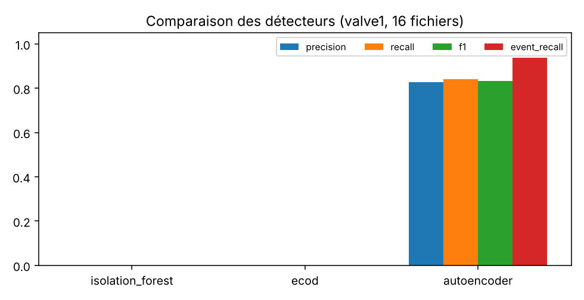

# Détection d'anomalies sur données de capteurs de banc d'essai

Prototype de détection d'anomalies **non supervisée** sur le jeu public [SKAB](https://github.com/waico/SKAB) (Skoltech Anomaly Benchmark, 8 capteurs, 1 mesure par seconde, banc de circulation d'eau). Il compare trois détecteurs (isolation forest, ECOD de PyOD, autoencodeur PyTorch), mesure précision, rappel et fausses alarmes, détecte des ruptures, et expose le tout via un tableau de bord Streamlit et une API FastAPI.

Statut : **prototype**. Pas de Docker, pas de multi-équipements, évalué sur un seul banc.

## Résultats (protocole par essai, 16 essais `valve1`)

| Modèle | Précision | Rappel | F1 | Taux de fausses alarmes | AUROC |
|---|---|---|---|---|---|
| Isolation forest | 0,00 | 0,00 | 0,00 | 0,00 | 0,65 |
| ECOD | 0,00 | 0,00 | 0,00 | 0,00 | 0,46 |
| Autoencodeur | 0,83 | 0,84 | 0,83 | 0,34 | 0,88 |

À lire avec précaution : 66 % des points évalués sont anormaux, donc une alarme permanente donnerait déjà un F1 de 0,80. Le gain de l'autoencodeur se lit dans l'AUROC (0,88) et le taux de fausses alarmes. L'isolation forest et ECOD ne déclenchent rien avec ce seuil. Le détail, le protocole, le test de transfert qui échoue et les limites sont dans [`results/report.md`](results/report.md).



## Protocole
- Entraînement uniquement sur du fonctionnement normal : les 540 premières secondes de chaque essai (80 % entraînement, 20 % calibration du seuil au quantile 0,995). Aucune étiquette d'anomalie n'est utilisée pour entraîner ou régler un seuil.
- Évaluation sur les points suivants, par point et par événement.
- Un modèle entraîné une fois sur `anomaly-free` puis appliqué aux essais **échoue** (décalage de régime : environ 89 °C contre 70 °C) ; ce résultat est documenté dans le rapport.

## Installation et lancement
```bash
python -m venv .venv
.venv\Scripts\activate            # Mac/Linux : source .venv/bin/activate
pip install -r requirements.txt
python scripts/get_data.py        # télécharge SKAB (licence GPL-3.0)
python -m anomaly.evaluate        # entraîne, évalue, régénère results/
streamlit run dashboard/app.py    # tableau de bord
uvicorn anomaly.api:app --port 8000   # API, doc Swagger sur /docs
pytest                            # tests
```

## Structure
```
anomaly/   data.py, features.py, detectors.py, metrics.py, evaluate.py, api.py
dashboard/ app.py (Streamlit)
tests/     tests unitaires et API
results/   metrics.csv, per_file.csv, changepoints.csv, report.md, figures
scripts/   get_data.py
```

## Pistes
Variables stationnarisées pour l'isolation forest et ECOD, seuil adaptatif, évaluation sur `valve2`, rapport automatique par essai, Docker, jeu de données de banc moteur.

## Données
SKAB : Katser & Kozitsin, Skoltech Anomaly Benchmark (2020), licence GPL-3.0. Les données ne sont pas redistribuées dans ce dépôt.
