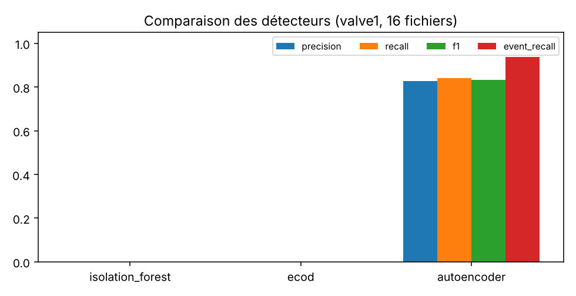
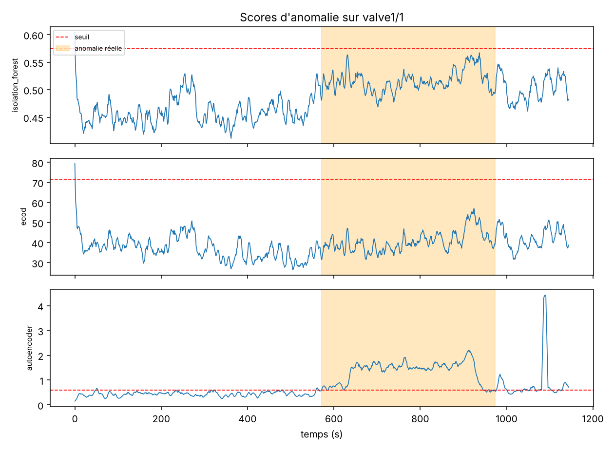

# Rapport d'évaluation : détection d'anomalies sur le banc SKAB

Rapport généré automatiquement par `python -m anomaly.evaluate` (graine 42).

## Données et protocole
- SKAB, `valve1` : 16 essais, 16 événements anormaux. Chaque essai commence par ~560 s de fonctionnement normal.
- Apprentissage **non supervisé** : aucune étiquette d'anomalie n'est utilisée pour entraîner ni pour régler un seuil.
- **Protocole principal (référence par essai)** : les 540 premières secondes de chaque essai servent de référence normale (80 % entraînement, 20 % calibration du seuil au quantile 0.995). L'évaluation porte sur les points **après** cette référence. C'est le fonctionnement d'une campagne de banc : on compare un essai à son propre début.
- **Protocole de transfert** : un seul modèle entraîné sur `anomaly-free` (9405 points) puis appliqué à tous les essais.
- Après la référence, 66% des points sont anormaux. **Un détecteur qui déclenche l'alarme en permanence obtient donc une précision de 0.66, un rappel de 1 et un F1 de 0.80** : le F1 seul ne suffit pas, il faut lire `fpr` et `auroc` avec lui.
- Scores lissés sur 5 s. Entrées : valeurs brutes + moyenne et écart-type glissants sur 10 s (isolation forest, ECOD) ; fenêtres de 10 s (autoencodeur).

## Résultats : protocole principal (référence par essai)
| model            |   precision |   recall |    f1 |   fpr |   auroc |   auprc |   event_recall |   false_alarm_runs |
|:-----------------|------------:|---------:|------:|------:|--------:|--------:|---------------:|-------------------:|
| isolation_forest |       0     |     0    | 0     | 0     |   0.651 |   0.769 |          0     |                  0 |
| ecod             |       0     |     0    | 0     | 0     |   0.455 |   0.614 |          0     |                  0 |
| autoencoder      |       0.828 |     0.84 | 0.834 | 0.344 |   0.883 |   0.945 |          0.938 |                 58 |

Meilleur F1 par point : **autoencoder** (0.834), avec un `fpr` de 0.34 et 58 séries de fausses alarmes sur 16 essais. L'isolation forest et ECOD ne déclenchent aucune alarme avec ce seuil, et leur `auroc` (0.65 et 0.46) montre qu'ils ordonnent mal les points. Hypothèse, non vérifiée ici : sur des variables en niveau, une dérive lente (la température moyenne diffère déjà d'un essai à l'autre) domine le signal de la vanne. L'autoencodeur, qui apprend les relations entre capteurs, ordonne nettement mieux (`auroc` 0.88), mais son F1 est proche de celui de l'alarme permanente : son vrai gain se lit dans `fpr` et `auroc`, et il produit encore beaucoup de fausses alarmes. Piste suivante : des variables stationnarisées (différences, résidus par rapport à une moyenne mobile longue).

## Résultats : transfert depuis `anomaly-free`
| model            |   precision |   recall |    f1 |   fpr |   auroc |   auprc |   event_recall |   false_alarm_runs |
|:-----------------|------------:|---------:|------:|------:|--------:|--------:|---------------:|-------------------:|
| isolation_forest |       0.663 |    1     | 0.797 | 1     |   0.521 |   0.683 |          1     |                  0 |
| ecod             |       0.748 |    0.014 | 0.028 | 0.009 |   0.572 |   0.707 |          0.562 |                  4 |
| autoencoder      |       0.663 |    1     | 0.797 | 1     |   0.599 |   0.78  |          1     |                  0 |

Ce protocole échoue (le F1 de 0.80 correspond à une alarme permanente, `fpr` = 1.00) : le fichier `anomaly-free` a une température moyenne d'environ 89 °C, contre environ 70 °C dans les essais `valve1`. Les modèles considèrent presque tout comme anormal (ou, pour ECOD, presque rien). Un modèle entraîné sur un autre régime de fonctionnement ne se transfère pas sans normalisation par essai.

## Lecture des colonnes
- `precision`, `recall`, `f1`, `fpr` : par point, seuil fixé sur le normal uniquement.
- `auroc`, `auprc` : indépendantes du seuil.
- `event_recall` : part des événements avec au moins une alarme ; `false_alarm_runs` : séries d'alarmes hors de tout événement.

## Ruptures (ruptures, Binseg)
Précision 0.27, rappel 0.458 (tolérance 15 s, moyenne sur les essais). La pénalité (80) a été choisie après avoir regardé une petite grille sur ces mêmes fichiers : résultat légèrement optimiste.

## Limites
- Banc de circulation d'eau, pas un banc moteur : les résultats ne se transposent pas tels quels.
- Le seuil par quantile règle le compromis faux positifs / rappel ; il n'est pas optimisé.
- Évaluation par point sévère pour des anomalies progressives ; l'évaluation par événement est plus indulgente.
- Les anomalies de `valve1` sont injectées par un opérateur (fermeture de vanne), pas des pannes naturelles.
- `valve2` n'est pas utilisé ici.

Environnement : Python 3.13.16, scikit-learn 1.9.1, torch 2.15.0.
